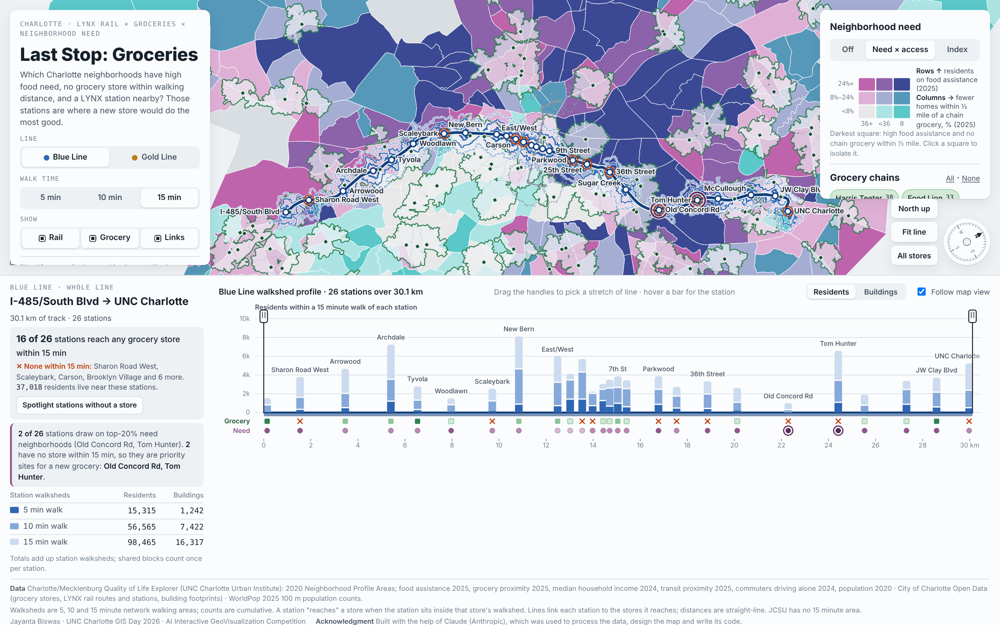

# Last Stop: Groceries

**Which Charlotte neighborhoods have high food need, no grocery store within walking distance, and a LYNX station nearby? Those stations are where a new store would do the most good.**

An interactive map of Charlotte, North Carolina, built for the UNC Charlotte GIS Day 2026 **AI Interactive GeoVisualization Competition** (topic: Food Security). It colors Charlotte's 459 Neighborhood Profile Areas (NPAs) by food need, using data from the **Charlotte/Mecklenburg Quality of Life Explorer**. On top of that it draws the walking areas around every LYNX Blue Line and Gold Line station and every grocery store. Neighborhoods with high need that lie beyond a walk to any store stand out, and the stations that serve them are flagged as priority sites for a new grocery.



**Live map:** `https://<your-github-username>.github.io/<repository-name>/`

---

## The three questions

1. **Where is food need highest, and is there a store within walking distance?** The neighborhood layer crosses the share of residents on food assistance with the share of homes within ½ mile of a chain grocery (Quality of Life Explorer). Areas within a 5, 10 or 15 minute walk of a store are washed out, so the neighborhoods that stay vivid have high need and are beyond a walk to any store.
2. **Rail to groceries.** Step off the train at any LYNX station: is there a grocery store within a 5, 10 or 15 minute walk? Stations that reach a store are marked green in the profile strip; stations that don't are marked with a red ring on the map and a red ✕ in the profile.
3. **Who each store serves on foot.** For every grocery store, how many residents and buildings fall inside its 5, 10 and 15 minute walking area?

At a 15 minute walk with every chain included, **16 of 26 Blue Line stations** and **12 of 17 Gold Line stations** reach a grocery store. Narrow the walk or the chains and the gaps grow quickly.

With the default (equal) weights, **Old Concord Rd** and **Tom Hunter** on the northeast Blue Line are the two stations whose walksheds draw on top-20% need neighborhoods and that have no grocery store within even a 15 minute walk. They are the strongest candidates for a station-area grocery. No Gold Line station falls in the top 20% for need, though three West End stops (French Street, Johnson C. Smith University and Bruns Avenue) are in the next band.

Rail reaches only a small part of the need. The 92 top-20% need neighborhoods are home to about 198,000 people, and their median distance to a LYNX station is about 4 km. Only 6 of them lie at least half within a 15 minute walk of a station. The full write-up is in [`WRITEUP.md`](WRITEUP.md) and behind the *Read the write-up* button on the map.

## What you can do on the map

| Control | What it does |
|---|---|
| **Line** | Switch between the Blue Line and the Gold Line. The other line stays on the map in grey. |
| **Walk time** | Show 5, 10 or 15 minute walks. Changes the map, the profile, the totals and which stations count as reaching a store. |
| **Show** | Turn rail walksheds and grocery walksheds on or off. With both on, grocery walksheds are green fills and rail walksheds are contour lines. |
| **Read the write-up** | Opens the competition write-up (overview of the data, method, interpretation and summary) over the map. Station names in it are links that close the write-up and zoom to that station. Add `#writeup` to the page address to open it directly, for example from a QR code. |
| **Neighborhood need** | *Need × access* colors each NPA on a 3 × 3 grid: share of residents on food assistance (rows) against the share of homes within ½ mile of a chain grocery (columns). Click a square in the legend to show only that class. *Index* colors NPAs by a weighted need index; the sliders change the weight of each measure and the map, the station flags and the top-need list update as you drag. *Off* returns to the original walkshed map. |
| **Priority stations** | A purple ring marks a station whose walkshed draws on top-20% need neighborhoods and has no store within the chosen walk. The profile has a *Need* row under the grocery strip, and the readout names the priority stations in the selected section. |
| **Hover a neighborhood** | Shows its food assistance, income, grocery and transit proximity, commuting, need index rank, and which LYNX walksheds reach into it. Click to zoom to it. |
| **Grocery chains** | Filter by Harris Teeter, Food Lion, Walmart, Aldi, Publix, Target, Compare Foods, The Fresh Market or other grocers. |
| **Walkshed profile** | Each station is a bar placed at its distance along the line, showing residents or buildings within the walk. A strip underneath shows grocery access. |
| **Section handles** | Drag the two handles on the profile to select a stretch of line; the panel totals that section and lists stations with no store in reach. |
| **Hover** | Point at a station or a store for its residents, buildings and what it can reach on foot. Click to zoom in. |
| **Follow map view** | The profile shows only the part of the line visible on the map. |
| **Compass / Align with profile** | Rotate the map by dragging the compass; *Align with profile* turns the line to run left to right like the chart. |

The page works in light and dark mode and on phones. The same write-up is in `WRITEUP.md` for pasting into the submission form.

## Data

| Dataset | Source | Used for |
|---|---|---|
| Neighborhood Profile Areas (459, 2020 boundaries) | Charlotte/Mecklenburg Quality of Life Explorer | Neighborhood polygons |
| Public nutrition assistance, 2025 | Quality of Life Explorer (variable 80) | % of residents receiving food assistance |
| Grocery proximity, 2025 | Quality of Life Explorer (variable 45) | % of housing units within ½ mile of a chain grocery store |
| Household income, 2024 | Quality of Life Explorer (variable 37) | Median household income |
| Commuters driving alone, 2024 | Quality of Life Explorer (variable 10) | % of workers who drive to work alone (a car-access proxy) |
| Transit proximity, 2025 | Quality of Life Explorer (variable 36) | % of housing units within ½ mile of a transit stop (shown on hover) |
| Population 2020, housing units 2025 | Quality of Life Explorer (variables 47, 5) | Shown on hover; NPAs with no residents are left out of the index |
| Grocery stores (161) | City of Charlotte Open Data | Store locations and chain names |
| LYNX rail routes and stations | City of Charlotte Open Data | Blue and Gold Line track and stations |
| Building footprints | City of Charlotte Open Data | Building counts within each walkshed |
| Population | WorldPop 2025, 100 m population counts | Residents within each walkshed |

## Method

### Neighborhood need (Quality of Life Explorer)

1. **Data.** The Quality of Life Explorer download (`qol-data.zip`, file dated 2 October 2026) gives NPA polygons in NC State Plane feet and one long table of every variable by NPA and year. The latest year of each variable was used. Polygons were simplified (40 ft tolerance) and reprojected to WGS 84 for the web. Every step in this section is in [`analysis.py`](analysis.py); see *Reproduce the analysis* below.
2. **Need × access (bivariate).** Food assistance is split into terciles (under 8%, 8–24%, 24% and over). Grocery proximity is split into three groups: no homes within ½ mile of a chain grocery; some homes, but below the median of the remaining NPAs (36%); and 36% or more.
3. **Need index.** Each of four measures is turned into a percentile rank across populated NPAs, oriented so that 1 means most need: more food assistance, lower median income, fewer homes near a chain grocery, and fewer commuters driving alone. The index is the weighted mean of the ranks (equal weights by default; weights from 0 to 3 can be set on the map). NPAs are colored by quintile, and the top quintile is *top 20% need*.
4. **Linking stations to neighborhoods.** Each station's 15 minute walkshed (10 minute where no 15 minute area exists) was intersected with the NPAs in State Plane feet. A station's need score is the area-weighted mean of the index across the NPAs its walkshed covers. A station is a *priority site* when that score is in the top quintile of NPA scores and no store from the selected chains is within the chosen walk time.

### Walksheds

1. **Walksheds.** 5, 10 and 15 minute walking areas were generated on the street network around each LYNX station and each grocery store. Areas are cumulative: the 15 minute area contains the 10 and 5 minute areas.
2. **Counts.** Building footprints and WorldPop 2025 population cells were summarised inside each walkshed.
3. **Rail-to-grocery access.** A station "reaches" a store within *n* minutes when the station sits inside that store's *n* minute walkshed. This matches what the map shows: a station inside a green area is within that walk of a store.
4. **Distance along the line.** Stations are placed on the profile by their distance along the track.
5. **Section totals** add up the walksheds of the stations in a section. Neighbouring stations' walksheds overlap, so shared blocks are counted once per station.

### Known limitations

- In the 2025 Quality of Life release, grocery proximity is blank for 149 NPAs and only five are recorded as 0%. In 2022, every NPA had a value and 142 were 0%. 81% of the NPAs that are blank in 2025 were 0% in 2022, so a blank is read as 0% (no homes within ½ mile of a chain grocery). Those NPAs are marked † on hover.
- Quality of Life grocery proximity counts *chain* grocery stores within ½ mile in a straight line. The walksheds use the city's 161-store list and network walking times, so the two measures of access can differ.
- Food assistance exceeds 100% in one NPA (370) in the source data; ranks are unaffected.
- Income and commuting come from American Community Survey 5-year estimates, which have margins of error, especially for small NPAs.
- Johnson C. Smith University (Gold Line) has no 15 minute walkshed in the source data.
- One BJ's Wholesale Club has no walkshed in the source data and appears as a point only.
- Population figures are model estimates from a 100 m grid and are rounded for display.
- If the basemap tiles can't be reached, the map draws on a plain background (see *Basemap* below).

## Reproduce the analysis

[`analysis.py`](analysis.py) rebuilds the neighborhood data embedded in the map and computes every figure in the write-up. It uses the default (equal) weights and the same rules as the map.

1. **Get the inputs.** Put them in a project folder laid out like this. The GitHub Pages folder sits inside the same project folder.

   ```
   project/
   ├── qol_data/       Quality of Life Explorer "Download Data" (qol-data.zip), unzipped:
   │                   Data_Download_20261002.csv, QOL_NPA_2020_final_projected.shp (+ .dbf .shx .prj)
   ├── Data/           blue_line_stops, gold_line_stops, blue_line_walk, gold_line_walk (.geojson),
   │                   blue_line_pop_build.xls, gold_line_pop_build.xls
   ├── DataGrocery/    grocery_stores.geojson, grocery_stores_walk.geojson
   └── github-page/    this folder: index.html, analysis.py, ...
   ```

   The Quality of Life data comes from the *Download Data* link on the [Quality of Life Explorer](https://maps.mecklenburgcountync.gov/qol/). The stations, stores and walksheds come from City of Charlotte Open Data, with walksheds built on the street network and WorldPop 2025 population summarised inside them.
2. **Install and run** (Python 3.9 or later):

   ```
   pip install geopandas pandas numpy shapely xlrd
   cd github-page
   python analysis.py                      # inputs from the folder above
   python analysis.py --root PATH          # or point to another project folder
   python analysis.py --embed index.html   # also refresh the data embedded in the map
   ```

3. **Outputs** go to `analysis_output/`:

   | File | Contents |
   |---|---|
   | `qol_npa_food.json` | Neighborhood polygons, Quality of Life values and station–neighborhood overlaps; embedded in `index.html` as `<script id="qol">` |
   | `npa_need.csv` | One row per NPA: values, percentile ranks, need index, rank, quintile, bivariate class, share within a 15 minute walk of a store and of a station, direction from Uptown, distance to the nearest station |
   | `station_need.csv` | One row per station: shortest walk to a store, nearest store, need score and quintile, residents within 15 minutes, priority flag |
   | `summary.json` | Every figure quoted in `WRITEUP.md` |

The script takes a few seconds and prints the main results.

## Run it

The whole map is one self-contained file, `index.html`. All data, including the Quality of Life Explorer neighborhoods, is embedded in the page, and it loads [D3.js](https://d3js.org/) 7.9.0 from cdnjs, [MapLibre GL JS](https://maplibre.org/) 4.7.1 from unpkg, and fonts from Google Fonts. No API keys are required.

- **Locally:** open `index.html` in a browser.
- **GitHub Pages:** push `index.html`, `README.md`, `WRITEUP.md`, `analysis.py`, `analysis_output/`, `screenshot.png` and the `.github/workflows/deploy-pages.yml` file to the `main` branch of a repository. Then go to *Settings → Pages → Build and deployment* and set *Source* to **GitHub Actions**. Every push to `main` redeploys the map to `https://<your-github-username>.github.io/<repository-name>/`. The workflow uses current Pages actions that run on Node.js 24, which avoids the Node.js 20 deprecation warning from the older *Deploy from a branch* option.

## Basemap

Streets come from [OpenFreeMap](https://openfreemap.org/) vector tiles (OpenStreetMap data), drawn with [MapLibre GL JS](https://maplibre.org/), an open-source map library. **No account, API key or token is needed**, so there is nothing secret in the repository.

The OpenFreeMap *Positron* style is recoloured at load time to match the map's palette: white roads on the page's grey ground, muted water and parks, and points of interest and transit labels hidden so the walksheds stay readable. In dark mode the same style is recoloured to slate. Walkshed fills are drawn at about 75% opacity so the street grid shows through, and the basemap turns with the compass.

If the tiles can't be reached, the map falls back to a plain background and everything else keeps working. The attribution in the corner (OpenFreeMap © OpenMapTiles, data © OpenStreetMap contributors) is required; keep it visible.

## Built with

- [D3.js](https://d3js.org/) for projection, zoom, scales and the profile chart
- HTML Canvas for the walkshed overlay
- [MapLibre GL JS](https://maplibre.org/) with [OpenFreeMap](https://openfreemap.org/) tiles for the basemap (© OpenMapTiles, © OpenStreetMap contributors)
- Python (GeoPandas, Shapely, pandas, NumPy) for data preparation and analysis, in `analysis.py`
- Typefaces: Archivo, Public Sans and IBM Plex Mono (Google Fonts)

## Author

**Jayanta Biswas**, University of North Carolina at Charlotte
Entry for the UNC Charlotte GIS Day 2026 AI Interactive GeoVisualization Competition.

## Acknowledgment

This map was built with the help of **Claude** (Anthropic), a generative AI assistant, which was used to process the data (including the Quality of Life Explorer download), design the map and write its code. Analysis choices, data sources and final review are the author's.

## Data credits

Charlotte/Mecklenburg Quality of Life Explorer, UNC Charlotte Urban Institute, with Mecklenburg County and the City of Charlotte ([maps.mecklenburgcountync.gov/qol](https://maps.mecklenburgcountync.gov/qol/)) · City of Charlotte Open Data · WorldPop (www.worldpop.org), 2025 population counts at 100 m resolution · Basemap: OpenFreeMap, © OpenMapTiles, © OpenStreetMap contributors. Please check each provider's terms before reusing the data.
